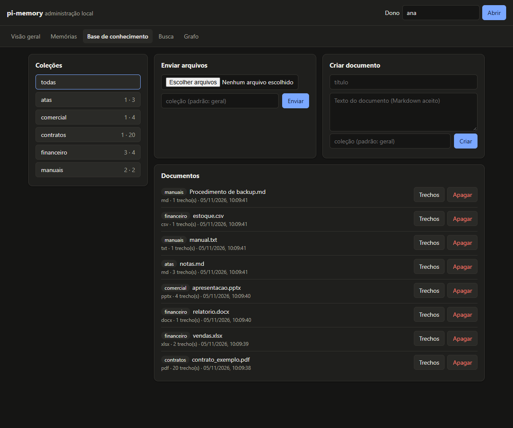

# pi-memory

[](https://github.com/Pedro-Bianco/pi-memory/actions/workflows/tests.yml)


> **In English.** pi-memory is a Python library that gives any AI assistant long-term memory: it
> extracts facts from conversations and decides to add, update, delete or ignore each one
> (93% correct on 58 recorded cases with a local `qwen2.5:14b`, zero wrong deletions). It also
> keeps a document knowledge base with hybrid search and page-level citations, plus a topic graph.
> Local by default (FastEmbed + Ollama + Qdrant), every engine is pluggable, and the same JSON is
> served as a library, CLI, HTTP server with a local admin page, and MCP server. Docs are in
> Brazilian Portuguese.


*Execução real: Ollama `qwen2.5:14b` com os motores padrão; falas e decisões sem edição
(as respostas do assistente na sessão 1 foram omitidas para caber).*

Memória de longo prazo, base de documentos com busca híbrida e grafo de memória por assunto, para
qualquer projeto Python. Local por padrão (FastEmbed + Ollama + Qdrant, sem chave e sem internet
depois de baixar os modelos), com cada peça trocável.

> **v0.1.0.** Memória de longo prazo, base de conhecimento com coleções, grafo, linha de
> comando, servidor HTTP com página de administração local e servidor MCP. Os números abaixo são
> de execuções registradas em `eval/results/`.

## Documentação

- **[Guia completo](https://github.com/Pedro-Bianco/pi-memory/blob/main/docs/GUIA.md)**: o problema que o projeto resolve, conceitos, arquitetura,
  como a memória decide, busca híbrida, referência da API, formatos JSON, motores, limites e
  perguntas frequentes.
- **[Notebooks executados](https://github.com/Pedro-Bianco/pi-memory/tree/main/examples/notebooks/)**: memória, documentos, um agente real com
  memória (duas sessões), um agente com ferramentas de memória, troca de motores, grafo e
  administração.
- **[llms.txt](https://github.com/Pedro-Bianco/pi-memory/blob/main/llms.txt)**: índice curto para modelos de linguagem e agentes de código.

## O que faz

- **Memória de longo prazo**: recebe uma conversa, extrai os fatos sobre a pessoa com um modelo
  de linguagem e decide, para cada fato, se **guarda**, **substitui** uma memória antiga,
  **apaga** uma que deixou de ser verdade ou **ignora** (já sabia). Na dúvida, guarda: nunca
  apaga por palpite.
- **Base de documentos**: PDF, Word (.docx), planilhas (.xlsx, .csv), apresentações (.pptx) e
  texto (.txt, .md). Busca por significado **e** por palavra exata (códigos como `NF-4521`), e
  cada resultado diz de onde veio: “contrato.pdf, página 12”, “vendas.xlsx, aba Vendas,
  linhas 1–5”, “apresentacao.pptx, slide 3 (notas)”.
- **Peças trocáveis**: embedding, modelo de linguagem, banco vetorial, leitores de documento,
  divisão em trechos e prompts ficam atrás de interfaces pequenas. Também aceita qualquer função
  `texto -> texto` como modelo de linguagem.
- **Coleções e administração**: documentos organizados em coleções (`contratos`, `manuais`...);
  dá para ver e apagar coleções inteiras, documentos e trechos, criar documentos digitando o
  texto e ver a visão geral de cada dono.
- **Linha de comando, HTTP e MCP**: as mesmas operações da biblioteca, com o mesmo JSON, para
  usar de qualquer linguagem, do terminal ou de um agente de IA.
- **Administração local no navegador**: `pi-memory serve-http` abre em `http://127.0.0.1:8765/`
  uma página para ver e controlar memórias, coleções, documentos, trechos, busca e grafo, só na
  sua máquina.
- **Cada dono separado**: toda operação recebe um `owner`; memórias e documentos de um não
  aparecem para outro (testado nas 22 operações, em todos os transportes e bancos). Quem
  autentica o usuário e escolhe o `owner` é o seu sistema; o token do servidor embutido libera
  todos os donos ([guia, 11.5](https://github.com/Pedro-Bianco/pi-memory/blob/main/docs/GUIA.md#115-vários-usuários)).

## Instalação

Requer Python 3.10+ (Windows, Linux ou macOS) e, para a configuração padrão, o
[Ollama](https://ollama.com) aberto com um modelo baixado.

```bash
pip install "pi-memory[local] @ git+https://github.com/Pedro-Bianco/pi-memory"
ollama pull qwen2.5:14b
```

O extra `local` traz FastEmbed, Qdrant e leitura de PDF. O pacote base depende só de `httpx`.
Na primeira execução o FastEmbed baixa o modelo de embedding; depois tudo roda sem internet.

## Uso

```python
from pi_memory import PiMemory
from pi_memory.engines.llms.ollama import OllamaLLM

with PiMemory(path="minha_memoria", llm=OllamaLLM(model="qwen2.5:14b")) as pm:
    pm.memories.add("meu nome é Ana e moro em Curitiba", owner="ana")
    pm.memories.add("me mudei para Recife", owner="ana")      # substitui Curitiba
    print(pm.memories.search("onde a Ana mora?", owner="ana"))

    pm.documents.add("contrato.pdf", owner="ana")
    for r in pm.documents.search("prazo de entrega", owner="ana")["results"]:
        print(r["citation"]["label"], "→", r["text"][:80])
```

Com asyncio (FastAPI, agentes assíncronos), a mesma API com `await`:

```python
from pi_memory import AsyncPiMemory

async with AsyncPiMemory(path="minha_memoria") as pm:
    await pm.memories.add("me mudei para Recife", owner="ana")
    resultados = await pm.documents.search("prazo de entrega", owner="ana")
```

## Linha de comando, servidores e administração

```bash
pi-memory --path dados --format text stats --owner ana
pi-memory --path dados documents add --owner ana --collection contratos --path contrato.pdf
pi-memory --path dados documents search --owner ana --query "NF-4521"
pi-memory schema memories.search      # esquema JSON dos parâmetros (para agentes)
pi-memory --path dados serve-http      # administração local em http://127.0.0.1:8765/
PI_MEMORY_TOKEN=... pi-memory --path dados serve-http   # exige Authorization: Bearer
pi-memory --path dados serve-mcp       # ferramentas para agentes compatíveis com MCP
```



Detalhes de cada comando, do HTTP e do MCP no [guia](https://github.com/Pedro-Bianco/pi-memory/blob/main/docs/GUIA.md#125-operações-linha-de-comando-http-e-mcp).

## Motores

| Peça | Incluídos | Extra para instalar |
|---|---|---|
| Embedding | `FastEmbedEmbedder` (padrão), `OllamaEmbedder`, `OpenAIEmbedder`, `GeminiEmbedder` | `fastembed` só para o FastEmbed |
| Modelo de linguagem | `OllamaLLM` (padrão), `OpenAILLM`, `GeminiLLM`, `AnthropicLLM`, qualquer função `texto -> texto` | nenhum |
| Banco vetorial | `QdrantStore` (padrão; pasta local ou servidor), `ChromaStore`, `MemoryStore` (sem dependências) | `qdrant`, `chroma` |

```python
from pi_memory import PiMemory
from pi_memory.embedders import OllamaEmbedder, GeminiEmbedder
from pi_memory.llms import OpenAILLM, GeminiLLM, AnthropicLLM
from pi_memory.stores import ChromaStore, MemoryStore

pm = PiMemory(embedder=OllamaEmbedder("nomic-embed-text"), store=ChromaStore(path="dados"))
pm = PiMemory(llm=GeminiLLM("gemini-3.5-flash"))                 # chave em GEMINI_API_KEY
pm = PiMemory(llm=OpenAILLM("qwen2.5:14b", base_url="http://localhost:11434/v1"))  # formato OpenAI
pm = PiMemory(llm=lambda prompt: minha_funcao(prompt), store=MemoryStore())
```

- **Chaves de API** só por parâmetro ou variável de ambiente (`OPENAI_API_KEY`, `GEMINI_API_KEY`,
  `ANTHROPIC_API_KEY`); nunca vão para disco nem para mensagens de erro.
- **Formato OpenAI** serve para a OpenAI e para qualquer serviço compatível (`base_url`): o
  próprio Ollama em `/v1`, LM Studio, OpenRouter, Groq.
- **Modelos de nuvem não têm padrão**: os nomes mudam rápido (em 2026-11-04 o
  `gemini-2.5-flash` já era recusado para contas novas). O embedding `gemini-embedding-001` é o
  padrão do `GeminiEmbedder`.
- **Gemini** vai pela API do Google AI Studio. O Vertex AI (com região escolhida, como São Paulo)
  ainda não é suportado; está registrado como motor futuro.
- **Erros passageiros** (429 limite de uso, 503 demanda alta) são tentados de novo duas vezes,
  com espera de 2 s e 5 s; os demais falham na hora com mensagem em português.
- **Trocar de embedding** numa memória existente é recusado com explicação (vetores de modelos
  diferentes não se misturam). Para migrar: abra com o modelo antigo e chame
  `pm.reindex(novo_embedder)`.
- **Configuração em JSON** (para servidores e linha de comando):
  `PiMemory.from_config({"embedder": {"type": "ollama", "model": "nomic-embed-text"}, "llm": {"type": "gemini", "model": "gemini-3.5-flash"}, "store": {"type": "chroma", "path": "dados"}})`.

Sem `llm=`, a biblioteca usa o Ollama com o `qwen2.5:14b`, o modelo que passou na avaliação
(veja a comparação abaixo). Os exemplos passam o modelo explicitamente só para ficar claro; o
único medido acima da
meta até agora: veja a comparação abaixo.

## Como funciona

1. **Extração**: a conversa (até 16 mensagens por vez) vira linhas `FATO:` e `DEIXOU:`. Falas
   do assistente só servem de contexto: nada que só o assistente disse vira memória.
2. **Assunto**: cada fato recebe um assunto de uma lista configurável (perfil, família, trabalho,
   saúde, ...).
3. **Decisão**: cada fato é comparado com as 3 memórias mais parecidas do mesmo dono (por
   significado); o modelo
   responde `ADD`, `UPDATE n`, `DELETE n` ou `DUPLICATE`. Resposta confusa, número fora da lista
   ou erro do modelo nessa etapa: o fato é guardado e nada é apagado.
4. **Busca híbrida**: vetor de significado + termos da palavra exata, combinados com a fusão
   DBSF. No Qdrant isso é nativo; nos outros bancos a biblioteca faz a parte da palavra exata
   (BM25) e a fusão, com a mesma tokenização.

## Testes

```bash
pip install -e ".[local,dev]"
pytest                    # 188 testes, sem rede e sem modelos (motores falsos)
pytest -m real_engines    # motores reais, sem custo (veja abaixo)
pytest -m browser         # página de administração no Chrome (precisa do Playwright)
```

- Os testes rápidos rodam a mesma bateria de contrato no banco em memória, no Qdrant local e no
  Chroma, e os cenários de memória e documentos nos três. Os motores de nuvem são testados contra
  servidores simulados (formato do pedido, leitura da resposta, erros, chave mascarada), e a mesma
  sequência de operações dá o mesmo JSON pela biblioteca, HTTP, MCP e linha de comando. A CI
  roda em Windows, Linux e macOS com Python 3.10 a 3.13.
- Os testes reais usam o Ollama local (API própria e formato OpenAI em `/v1`), o FastEmbed e a
  faixa gratuita do Gemini; cada um é pulado com o motivo quando o serviço ou a chave não existe.
  Última execução (2026-11-04): 6 passaram, 1 pulado (Anthropic, sem chave).

## Resultados medidos

Avaliação com motores reais, separada dos testes. Todos os dados são fictícios.

```bash
python eval/run.py --suite memory --llm-model qwen2.5:14b
python eval/run.py --suite documents
python eval/report.py --write     # atualiza as tabelas abaixo a partir de eval/results/
```

<!-- resultados:inicio -->
### Memória: decisões de guardar, substituir, apagar ou ignorar

58 conversas fictícias (`eval/cases/memory.jsonl`). Um caso passa quando as memórias finais têm o que deviam ter e não guardam o que deviam ter esquecido. Apagamento indevido = uma memória que devia continuar e sumiu. Embedding `fastembed:intfloat/multilingual-e5-large`, banco Qdrant local. Meta: ≥ 85% e 0 apagamentos indevidos.

| Modelo (Ollama) | Acerto | Apagamentos indevidos | Tempo por conversa (mediana) | p95 | Arquivo |
|---|---|---|---|---|---|
| `qwen2.5:14b` | 54/58 (93,1%) | 0 | 6,7 s | 11,2 s | `2026-11-04-memory-qwen2.5-14b.json` |
| `qwen3:8b` | 36/56 (64,3%) | 0 | 1,7 s | 11,1 s | `2026-11-04-memory-qwen3-8b.json` |
| `qwen3:4b-instruct` | 34/56 (60,7%) | 0 | 0,4 s | 2,0 s | `2026-11-04-memory-qwen3-4b-instruct.json` |

Os modelos não foram medidos com o mesmo número de casos (casos novos entram quando um erro real é encontrado): compare pela fração de cada linha.

Acerto por tipo de caso:

| Tipo | `qwen2.5:14b` | `qwen3:8b` | `qwen3:4b-instruct` |
|---|---|---|---|
| fato novo | 12/12 | 6/12 | 8/12 |
| complementa sem substituir | 4/5 | 3/5 | 3/5 |
| substitui | 12/14 | 3/12 | 3/12 |
| apaga | 8/8 | 6/8 | 2/8 |
| repetido (ignora) | 8/8 | 8/8 | 8/8 |
| sem fato (cumprimento, comando) | 6/6 | 6/6 | 6/6 |
| só o assistente disse | 3/3 | 3/3 | 3/3 |
| conversa longa | 1/2 | 1/2 | 1/2 |

Casos que falharam com `qwen2.5:14b`:

- `complement-05`: faltou “lia”. Memórias finais: “O usuário tem uma filha chamada Bia que nasceu ontem.”.
- `update-05`: faltou “livraria”, sobrou “padaria”. Memórias finais: “O usuário trabalha na Padaria Exemplo”.
- `update-09`: sobrou “engenharia”. Memórias finais: “O usuário deixou de estudar engenharia”; “O usuário começou a estudar direito”.
- `long-01`: faltou “professor”. Memórias finais: “O usuário é casado com um homem chamado Caio”; “O usuário faz pilates às terças”; “O usuário cuida do seu filho Davi à tarde”; “O usuário dá aula de manhã”.

Máquina: Windows-11-10.0.26200-SP0, CPU AMD64 Family 25 Model 33 Stepping 2, AuthenticAMD, Python 3.12.10. Data: 2026-11-04.

### Documentos: busca com citação

52 perguntas em linguagem natural (com palavras diferentes das do texto) e 12 termos exatos (códigos, nomes, números) sobre 7 documentos fictícios em todos os formatos (`eval/fixtures/`). Acerto = o trecho com a resposta (arquivo + página, slide, aba ou seção) está entre os 3 primeiros. Termo exato = o 1º resultado contém o termo. Embedding `fastembed:intfloat/multilingual-e5-large`. Metas: ≥ 90% e ≥ 95%.

| Banco | Trecho certo no top 3 | Citação certa nos acertos | Termo exato em 1º | Busca (mediana) | Busca p95 | Indexação dos 7 arquivos |
|---|---|---|---|---|---|---|
| memory | 49/52 (94,2%) | 49/49 | 12/12 (100,0%) | 43 ms | 48 ms | 1,8 s |
| qdrant-local | 50/52 (96,2%) | 50/50 | 11/12 (91,7%) | 43 ms | 46 ms | 4,4 s |

Casos que falharam:

- memory, `doc-02` “Qual é o objeto do contrato?”: esperado “contrato_exemplo.pdf, página 2”, veio relatorio.docx, trecho 1; contrato_exemplo.pdf, página 20; contrato_exemplo.pdf, página 1.
- memory, `doc-09` “Como é corrigido o valor do contrato a cada ano?”: esperado “contrato_exemplo.pdf, página 9”, veio apresentacao.pptx, slide 3; contrato_exemplo.pdf, página 7; contrato_exemplo.pdf, página 15.
- memory, `doc-14` “Como funciona o cancelamento do contrato?”: esperado “contrato_exemplo.pdf, página 14”, veio contrato_exemplo.pdf, página 20; contrato_exemplo.pdf, página 17; contrato_exemplo.pdf, página 1.
- qdrant-local, `doc-02` “Qual é o objeto do contrato?”: esperado “contrato_exemplo.pdf, página 2”, veio relatorio.docx, trecho 1; contrato_exemplo.pdf, página 1; contrato_exemplo.pdf, página 6.
- qdrant-local, `doc-09` “Como é corrigido o valor do contrato a cada ano?”: esperado “contrato_exemplo.pdf, página 9”, veio apresentacao.pptx, slide 3; contrato_exemplo.pdf, página 7; relatorio.docx, trecho 1.
- qdrant-local, `term-03` “nota fiscal NF-4521”: esperado “contrato_exemplo.pdf, página 7”, veio vendas.xlsx, aba Vendas, linhas 1–5; contrato_exemplo.pdf, página 7; contrato_exemplo.pdf, página 15.

Arquivo: `2026-11-04-documents-multilingual-e5-large.json`. Máquina: Windows-11-10.0.26200-SP0, CPU AMD64 Family 25 Model 33 Stepping 2, AuthenticAMD, Python 3.12.10. Data: 2026-11-04.

### Velocidade da busca

Banco carregado com textos fictícios e vetores aleatórios de 1024 dimensões (mede o banco e a busca híbrida; calcular 50 mil embeddings reais em CPU levaria horas). A pergunta é transformada em vetor pelo modelo real `fastembed:intfloat/multilingual-e5-large`: mediana 40 ms, p95 40 ms. Total = busca + vetor da pergunta. Meta: p95 < 1 s com 10 mil memórias ou 50 mil trechos.

| Banco | Registros | Busca (mediana) | Busca p95 | **Total p95** | Carga |
|---|---|---|---|---|---|
| memory | 10.000 | 670 ms | 680 ms | **720 ms** | 7,1 s |
| qdrant-local | 10.000 | 270 ms | 300 ms | **340 ms** | 153,8 s |
| qdrant-local | 50.000 | 1,4 s | 1,4 s | **1,4 s** | 781,2 s |
| chroma | 10.000 | 40 ms | 50 ms | **90 ms** | 22,6 s |
| chroma | 50.000 | 220 ms | 240 ms | **280 ms** | 134,4 s |

O banco em memória (`MemoryStore`, Python puro) só foi medido até 10 mil registros: ele serve para testes e usos pequenos.

Arquivo: `2026-11-04-speed-multilingual-e5-large.json`. Máquina: Windows-11-10.0.26200-SP0, CPU AMD64 Family 25 Model 33 Stepping 2, AuthenticAMD, Python 3.12.10. Data: 2026-11-04.
<!-- resultados:fim -->

### Leitura das falhas

- **Memória**: os erros de `qwen2.5:14b` são de decisão, não de leitura: duas vezes o modelo
  trocou um fato que devia **somar** (a filha Bia substituiu a filha Lia; “professora” virou
  “dá aula de manhã”), uma vez a extração não achou fato em “saí da padaria e entrei na
  livraria”, e uma vez guardou “deixou de estudar engenharia” em vez de apagar (o sentido está
  certo, mas o caso exige que “engenharia” suma). Nenhuma memória correta foi apagada por engano
  em nenhum modelo.
- **Busca na memória**: devolve as 3 memórias mais próximas, e a certa nem sempre vem em 1º. No
  teste real com duas memórias, “onde a Ana mora?” trouxe primeiro “O nome do usuário é Ana
  Exemplo” (a palavra exata “Ana”) e em 2º “O usuário mora em Recife”. Use as 3, não só a
  primeira.
- **Qwen3**: com os mesmos prompts, a extração dos modelos `qwen3` muitas vezes responde `NULO`
  e o fato se perde; o formato da resposta está certo. Os prompts foram medidos primeiro com a
  família `qwen2.5`.
- **Tempo**: inclui extração, assunto e uma decisão por fato, com o Ollama local nesta máquina.
  A mediana baixa dos `qwen3` vem em parte de conversas em que nada foi extraído (uma chamada
  só); compare o tempo junto com o acerto. Em outra máquina os tempos mudam, mas as taxas de
  acerto devem se manter com o mesmo modelo.
- **Documentos**: as perguntas que falham são as genéricas (“qual é o objeto do contrato?”), em
  que outras páginas do mesmo contrato também parecem responder. No termo exato, o caso que
  falha no Qdrant é a expressão “nota fiscal NF-4521”: o 1º resultado é a planilha, que tem
  “NF-4521” mas não “fiscal”.

- **Velocidade**: a meta (p95 < 1 s) foi cumprida no Chroma com 10 mil e 50 mil registros e no
  Qdrant local com 10 mil, mas **não** no Qdrant local com 50 mil (1,4 s). No modo local embutido
  a busca é feita pelo cliente Qdrant em Python, sem o índice do servidor, e carregar 50 mil
  registros levou cerca de 13 minutos. Para bases grandes, use o Chroma ou o Qdrant em servidor
  (`QdrantStore(url=...)`; este último ainda não foi medido aqui).

### Ajustes feitos com medição

| Mudança | Antes | Depois |
|---|---|---|
| Ao separar códigos, descartar pedaços de 1 caractere (o “2” de “7.2” casava com “2%”) | termo exato no Qdrant 10/12 | 11/12 |
| No Qdrant, pesar a repetição de termos como o BM25 (saturação) em vez da contagem crua | trecho certo no top 3 no Qdrant 49/52 | 50/52 |
| Candidatas da decisão só por significado (antes: busca híbrida). Com a híbrida, “usuário” no fato puxava as memórias no masculino e “A usuária mora em Curitiba” ficava de fora: “me mudei para Recife” substituiu a memória do **nome** | 57 casos: 53/57; caso `update-14` errado | 57 casos: 53/57; caso `update-14` certo |
| Regra do termo exato: “o 1º resultado contém o termo”, porque `NF-4521` existe em dois documentos e a regra antiga exigia um deles | banco em memória 11/12 | 12/12 |

Os valores de partida (modelo e5, 8 frases por trecho com 1 de sobreposição, fusão DBSF, lista
fixa de assuntos) vêm de medições do autor anteriores a esta biblioteca, **não reproduzidas em
`eval/`**; cada uma está anotada com a data no código (`src/pi_memory/config.py`). Os números
que este README afirma são só os de `eval/results/`.

## Licença

MIT. Modelos e serviços escolhidos por quem usa a biblioteca seguem os termos deles.
