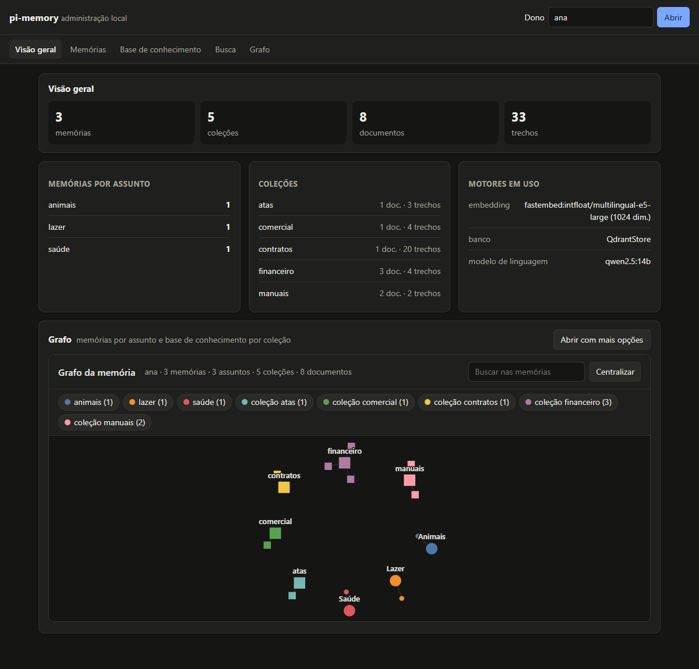
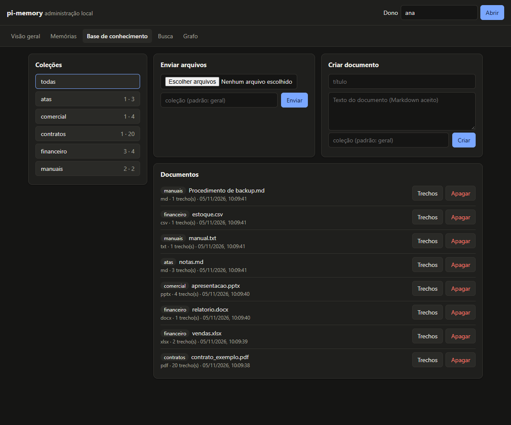
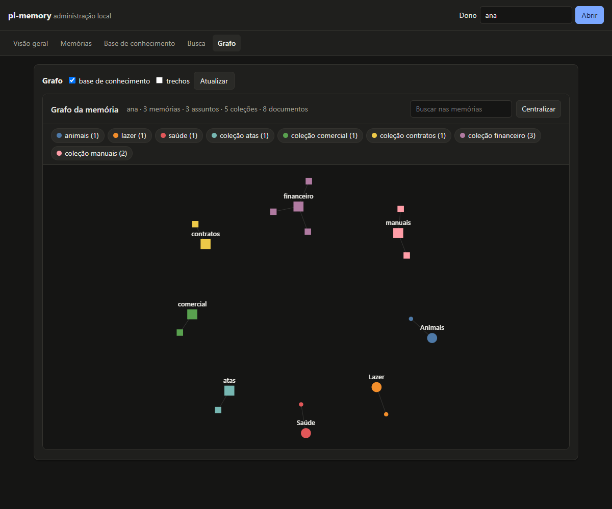

# pi-memory — guia completo

> Documento de referência do projeto, escrito para **pessoas e para modelos de linguagem**. Cada
> seção se sustenta sozinha, os nomes de funções e campos são exatos, e todo número de qualidade
> ou desempenho aponta para a execução registrada que o produziu. Se você é um LLM ajudando
> alguém a usar a biblioteca, leia a seção 1 e depois vá direto à seção que responde à pergunta;
> a [seção 12](#12-referência-da-api) tem todas as assinaturas.

**Versão descrita:** 0.1.0 (em construção). **Idioma da biblioteca:** português do Brasil
(prompts, mensagens de erro, documentação). **Licença:** MIT.

## Sumário

1. [Resumo em 30 segundos](#1-resumo-em-30-segundos)
2. [O problema](#2-o-problema)
3. [O que o pi-memory faz e o que não faz](#3-o-que-o-pi-memory-faz-e-o-que-não-faz)
4. [Conceitos](#4-conceitos)
5. [Arquitetura](#5-arquitetura)
6. [Como a memória decide](#6-como-a-memória-decide)
7. [Como a base de documentos funciona](#7-como-a-base-de-documentos-funciona)
8. [Busca híbrida em detalhe](#8-busca-híbrida-em-detalhe)
9. [Grafo por assunto](#9-grafo-por-assunto)
10. [Instalação](#10-instalação)
11. [Receitas de uso](#11-receitas-de-uso)
12. [Referência da API](#12-referência-da-api)
13. [Formatos JSON](#13-formatos-json)
14. [Motores incluídos](#14-motores-incluídos)
15. [Criar suas próprias peças](#15-criar-suas-próprias-peças)
16. [Qualidade medida](#16-qualidade-medida)
17. [Privacidade e segurança](#17-privacidade-e-segurança)
18. [Desempenho e limites conhecidos](#18-desempenho-e-limites-conhecidos)
19. [Perguntas frequentes](#19-perguntas-frequentes)
20. [Estado do projeto e próximos passos](#20-estado-do-projeto-e-próximos-passos)
21. [Glossário](#21-glossário)
22. [Mapa do repositório](#22-mapa-do-repositório)

---

## 1. Resumo em 30 segundos

O pi-memory é uma biblioteca Python que dá **memória** a assistentes e agentes de IA:

- **Memória de longo prazo**: você entrega a conversa; um modelo de linguagem extrai os fatos
  sobre a pessoa e decide, fato a fato, se **guarda**, **substitui** uma memória antiga, **apaga**
  uma que deixou de ser verdade ou **ignora**. Na dúvida, guarda e nunca apaga.
- **Base de documentos**: PDF, Word, planilhas, apresentações e texto viram trechos pesquisáveis
  por **significado** e por **palavra exata**, e cada resultado traz a **citação** ("contrato.pdf,
  página 12").
- **Grafo por assunto**: as memórias agrupadas por tema, como JSON e como página HTML interativa
  que abre sem internet.

Tudo **local por padrão** (FastEmbed + Ollama + Qdrant, sem chave, sem internet depois de baixar
os modelos) e **cada peça é trocável** (embedding, modelo de linguagem, banco vetorial, leitores,
divisão em trechos, prompts, apresentação do grafo).

```python
from pi_memory import PiMemory
from pi_memory.llms import OllamaLLM

with PiMemory(path="memoria", llm=OllamaLLM("qwen2.5:14b")) as pm:
    pm.memories.add("Sou a Ana, moro em Curitiba", owner="ana")
    pm.memories.add("Me mudei para Recife", owner="ana")           # substitui Curitiba
    print(pm.memories.search("onde a Ana mora?", owner="ana"))
```

---

## 2. O problema

### 2.1 Assistentes esquecem

Um modelo de linguagem só "sabe" o que está no prompt da chamada atual. Quando a conversa
acaba, ou passa do tamanho da janela de contexto, tudo que a pessoa contou se perde. Na
próxima sessão o assistente pergunta de novo o nome, a cidade, a profissão.

A saída óbvia, mandar o histórico inteiro a cada chamada, não escala: o histórico cresce sem
limite, fica caro e lento, e o modelo se perde em contexto longo.

### 2.2 Guardar não basta: é preciso manter atualizado

Guardar cada frase num banco vetorial e buscar depois (o RAG clássico aplicado à conversa) cria
outros problemas:

| Problema | Exemplo | O que acontece com "só guardar" |
|---|---|---|
| Contradição | "moro em Curitiba" → meses depois "me mudei para Recife" | as duas ficam; a busca pode trazer a errada |
| Fato que acabou | "tenho um carro" → "vendi o carro" | "tem um carro" continua sendo lembrado |
| Repetição | "sou enfermeira" dito em dez conversas | dez memórias iguais ocupam o contexto |
| Ruído | "oi, tudo bem?", "abre a previsão do tempo" | vira "memória" |
| Fala do assistente | o assistente sugere algo que a pessoa não confirmou | vira fato sobre a pessoa |
| Ausência | modelos pequenos escrevem "o nome do usuário não foi informado" | uma memória de ausência faz o assistente "esquecer" depois |

O pi-memory trata cada um desses casos: extrai só fatos afirmados pela pessoa, filtra ausências,
compara cada fato com as memórias parecidas e decide entre guardar, substituir, apagar ou
ignorar, com um recuo seguro para "guardar" quando a decisão não é clara (seção 6).

### 2.3 Documentos precisam de citação e de palavra exata

Para responder com base nos documentos de alguém, não basta achar "algo parecido": a resposta
precisa dizer **de onde veio** (para conferir) e precisa achar **códigos e números exatos**
(nota fiscal `NF-4521`, cláusula `7.2`). Busca só por significado empata códigos parecidos
(medido: "2024-0815" e "2024-0816" tiveram a mesma similaridade, 0,859). A seção 8 explica a
busca híbrida que resolve isso.

### 2.4 Cada projeto já tem a sua pilha

Um projeto usa Ollama, outro a OpenAI, outro o Gemini; um tem Qdrant, outro Chroma. Uma
biblioteca de memória presa a um motor só serve a quem já usa aquele motor. No pi-memory cada
peça fica atrás de uma interface pequena e trocar é só passar outro objeto na criação.

### 2.5 Privacidade

Memória é dado pessoal. Por padrão nada sai da máquina: os modelos rodam localmente, o banco é
uma pasta, não há telemetria. Motores de nuvem só quando você escolhe, com a sua chave.

---

## 3. O que o pi-memory faz e o que não faz

**Faz:**

- extrai fatos de conversas em português e mantém a memória coerente (guardar, substituir,
  apagar, ignorar), por **dono** (`owner`: usuário, sessão, agente — você escolhe);
- indexa PDF com texto, .docx, .xlsx, .csv, .pptx (com notas do orador), .txt e .md, com citação;
- busca híbrida (significado + palavra exata) igual em qualquer banco;
- organiza a base de conhecimento em **coleções** (ex. `contratos`, `manuais`) e deixa ver e
  apagar coleções inteiras, documentos e trechos individuais, além de criar documentos digitando o
  texto;
- gera o grafo das memórias por assunto e da base por coleção e documento (JSON e HTML);
- tem **linha de comando** completa, **servidor HTTP** (com página de administração local) e
  **servidor MCP**, todos com o mesmo JSON da biblioteca;
- detecta troca de modelo de embedding numa memória existente e oferece reindexação;
- erros em português, com o que fazer, e tempo limite em toda chamada externa.

**Não faz (nesta versão):**

- não é um agente nem um framework de agentes: é a peça de memória que o seu agente usa
  (seções 11.2 e 11.3 mostram como ligar);
- não faz OCR (PDF escaneado é recusado com explicação); não lê .doc, .xls, .ppt nem imagens;
- não autentica ninguém: `owner` é um rótulo que o seu sistema garante;
- com o Chroma 1.5.x, a leitura dos vetores às vezes falha ("Nothing found on disk", defeito
  do Chroma visto com muitos clientes no mesmo processo): o grafo vem sem as ligações de
  parecidas e com um aviso, em vez de falhar;
- não sincroniza memória entre processos diferentes usando o mesmo banco local (o Qdrant local
  trava a pasta; use um servidor Qdrant ou Chroma para vários processos);
- o servidor HTTP não tem HTTPS embutido: ouve só na própria máquina (127.0.0.1) e a página de
  administração é local, sem link público; para expor em rede, use `--token` e um proxy com
  HTTPS na frente (sem token, ouvir fora da máquina é recusado).

---

## 4. Conceitos

| Conceito | O que é | Onde aparece |
|---|---|---|
| **Dono** (`owner`) | texto livre que separa os dados: cada operação recebe um; dados de um dono nunca aparecem para outro | todos os métodos |
| **Memória** | um fato sobre o dono, escrito como frase ("O usuário mora em Recife"), com assunto, datas e metadados | `pm.memories` |
| **Decisão** | o que aconteceu com cada fato extraído: `add`, `update`, `delete` ou `none` | retorno de `memories.add` |
| **Assunto** (`topic`) | rótulo de uma lista configurável (padrão: perfil, família, trabalho, saúde, rotina, lazer, animais, casa, finanças, estudos, outros) | memórias, grafo |
| **Coleção** | uma base de conhecimento com nome dentro do dono (padrão `geral`); agrupa documentos | `pm.documents.collections` |
| **Documento** | um arquivo (ou texto digitado) adicionado a uma coleção; identificado por dono + coleção + nome | `pm.documents` |
| **Trecho** (chunk) | pedaço de um documento, com a localização (página, slide, aba, seção) | resultados de busca |
| **Citação** | `{doc_id, source, location, label}`; `label` pronto para mostrar: "contrato.pdf, página 12" | resultados de documentos |
| **Coleção do banco** | interno: onde o banco vetorial guarda memórias (`pi_memory_memories`) e trechos (`pi_memory_chunks`), com o registro do modelo de embedding; não confundir com as coleções da base de conhecimento | interno |
| **Motor** | implementação de uma peça: embedding, modelo de linguagem, banco vetorial | `pi_memory.embedders`, `.llms`, `.stores` |
| **Busca híbrida** | significado (vetor denso) + palavra exata (termos), combinados com a fusão DBSF | buscas |

---

## 5. Arquitetura

```text
 seu código (agente, app, script)
        │
        ▼
 PiMemory ──────────────── um objeto, sem estado global
   ├── .memories  MemoryService    extração → assunto → decisão; CRUD; busca
   ├── .documents DocumentService  leitura → trechos → vetores; busca com citação
   ├── .graph     GraphService     JSON do grafo; HTML pelo renderizador
   └── .reindex(), .from_config()
        │ usa só interfaces (pi_memory/interfaces.py)
        ▼
 ┌──────────────┬───────────────┬──────────────┬─────────────┬─────────┬───────────┬─────────────┐
 │ Embedder     │ LLM           │ VectorStore  │ DocumentRdr │ Chunker │ PromptSet │ GraphRender │
 │ FastEmbed*   │ Ollama*       │ Qdrant*      │ pdf, office │ frases* │ português*│ HTML*       │
 │ Ollama       │ formato OpenAI│ Chroma       │ txt/md/csv  │         │           │             │
 │ formato OpenAI│ Gemini       │ em memória   │ + os seus   │         │           │             │
 │ Gemini       │ Anthropic     │              │             │         │           │             │
 │              │ função str→str│              │             │         │           │             │
 └──────────────┴───────────────┴──────────────┴─────────────┴─────────┴───────────┴─────────────┘
   * padrão
```

Regras que a arquitetura garante (e testes verificam):

- **Nenhum módulo do núcleo importa um motor concreto.** Só `defaults.py` (o ponto de
  composição) e os pacotes de motores conhecem implementações. Teste:
  `tests/unit/test_import_boundaries.py`.
- **Importar não carrega dependências pesadas.** `pi_memory.embedders`, `.llms` e `.stores` só
  importam o motor quando o nome é usado. Teste: `test_public_modules_are_lazy`.
- **Mesmo comportamento em todo banco.** A mesma bateria de contrato e os mesmos cenários de
  memória e documentos rodam no banco em memória, no Qdrant e no Chroma
  (`tests/contract/test_store_contract.py`, `test_flows_all_stores.py`).
- **Um lugar para cada número.** Limiares e tamanhos ficam em `src/pi_memory/config.py`, com o
  comentário da medição que os justifica.

---

## 6. Como a memória decide

`pm.memories.add(conversa, owner)` executa quatro etapas.

### 6.1 Extração

A conversa vai ao modelo em janelas de até **16 mensagens** (conversas maiores são processadas
em partes). O prompt pede linhas:

```text
FATO: O usuário mora em Cidade Exemplo desde 2018
DEIXOU: O usuário vendeu a moto e não tem mais moto
NULO
```

- **Falas do assistente são contexto**, para entender um "sim, desde 2018"; o que só o
  assistente disse não vira fato.
- **Pedidos e comandos são ignorados** (abrir programas, música, perguntas gerais), assim como o
  conteúdo de documentos.
- **Filtro de ausência**: frases como "não foi informado", "desconhecido" são descartadas,
  porque modelos pequenos às vezes as escrevem como se fossem fatos.
- Leitura tolerante: aceita marcadores, numeração, negrito; linha sem rótulo conta como `FATO`.

Se o modelo **falhar** nesta etapa (fora do ar, tempo esgotado), a operação levanta exceção e
**nada é gravado**.

### 6.2 Assunto

Uma única chamada classifica todos os fatos novos num assunto da lista configurada
(`PiMemory(topics=[...])`). Resposta fora da lista vira `outros`. Por que lista fixa: no projeto
de origem, a lista fixa acertou 28 de 30 memórias, enquanto agrupar só por vetor manteve 43–49%
das ligações dentro do assunto.

### 6.3 Decisão, fato a fato

Para cada fato:

1. busca as **3 memórias mais parecidas do mesmo dono**, só por **significado** (seção 6.5);
2. se alguma tem **o mesmo texto** depois de normalizar (sem acento, sem caixa, sem pontuação
   nas pontas) → `none`, sem chamar o modelo;
3. se **não há nenhuma** memória parecida → `add` (ou `none`, se o fato é um `DEIXOU`: não há o
   que apagar, e "deixou de ser verdade" sozinho não é um fato útil);
4. senão, o modelo recebe as candidatas numeradas e responde uma linha:

```text
ADD          → complementar ou de outro assunto
DUPLICATE    → já está numa das memórias
UPDATE n     → substitui a memória [n] (mesmo assunto, valor novo)
DELETE n     → a memória [n] deixou de ser verdade
```

| Resposta | Evento no JSON | Efeito |
|---|---|---|
| `ADD` | `add` | nova memória |
| `DUPLICATE` | `none` | nada muda |
| `UPDATE n` | `update` | mesma memória (mesmo `id`), texto e assunto novos, `previous_text` no retorno |
| `DELETE n` | `delete` | memória apagada, `previous_text` no retorno |

### 6.4 Recuos de segurança

"Na dúvida, guardar" é regra do projeto: apagar por engano é pior que ter duas memórias
parecidas.

| Situação | Decisão | `reason` |
|---|---|---|
| resposta sem `ADD/UPDATE/DELETE/DUPLICATE` | `add` | `fallback_unclear` |
| número fora da lista de candidatas, ou `UPDATE`/`DELETE` sem número com várias candidatas | `add` | `fallback_unclear` |
| a memória alvo sumiu ou é de outro dono | `add` | `fallback_target_missing` |
| o modelo falhou na etapa de decisão | `add` | `fallback_engine_error` |

Na avaliação registrada, **nenhum modelo apagou uma memória correta** (seção 16).

### 6.5 Por que sempre as 3 mais parecidas

O projeto de origem só consultava o modelo quando a similaridade estava entre 0,72 e 0,89. Esse
número só vale para o modelo de embedding medido (e5); como aqui o embedding é trocável, a
decisão sempre recebe as 3 mais parecidas. Custa uma chamada por fato quando há candidatas.

**Por que só por significado aqui** (e híbrida na busca pública): num teste real, com as memórias
"O nome do usuário é Ana", "A usuária mora em Curitiba" e outras três, o fato "O usuário se mudou
para Recife" puxou pela palavra exata "usuário" as memórias escritas no masculino, e a da cidade
(no feminino) ficou fora das 3 candidatas; o modelo então substituiu a memória do **nome**. Só por
significado, a da cidade entra e é a substituída. Na avaliação com 57 casos as duas formas
empataram (53/57, nenhum apagamento indevido); o caso acima virou o caso `update-14`.

---

## 7. Como a base de documentos funciona

### 7.1 Leitura, por formato

| Formato | Leitor | Localização no trecho |
|---|---|---|
| `.pdf` (com texto) | `pypdf` (extra `pdf`) | `página N` |
| `.docx` | XML do pacote, biblioteca padrão (parágrafos e tabelas) | `trecho N` (20 parágrafos por seção; o Word não guarda páginas no arquivo) |
| `.pptx` | XML do pacote | `slide N` e `slide N (notas)` |
| `.xlsx` | XML do pacote (textos compartilhados, nomes das abas) | `aba Vendas, linhas 1–5` (40 linhas por seção; cada linha como `coluna: valor \| coluna: valor`) |
| `.csv` | `csv` (detecta `,` `;` tab `\|`) | `linhas 2–41` (linhas do arquivo; a 1 é o cabeçalho) |
| `.md` | cada título abre uma seção | `seção Pagamento` (antes do 1º título: `início`) |
| `.txt` | parágrafos | `trecho N` |

Textos em UTF-8; se não for, tenta cp1252 (comum em arquivos antigos do Windows).
Arquivo corrompido ou protegido por senha → `UnreadableDocumentError` com o nome do arquivo.
Extensão desconhecida → `UnsupportedFormatError` com a lista aceita e como plugar um leitor.

### 7.2 Divisão em trechos

Padrão: **8 frases por trecho, 1 compartilhada com o próximo**, sem atravessar seções (a citação
continua exata). Quebra de linha também encerra frase, então linhas de planilha e listas ficam
inteiras. Medido no projeto de origem: com 2 frases compartilhadas, um PDF de 100 páginas levava
129 s em vez de 105 s, com o mesmo resultado de busca.

### 7.3 Identidade e versões

- `doc_id` = hash de (dono + coleção + nome do arquivo). Mesmo nome, mesma coleção, mesmo dono →
  mesmo documento. Coleção e nome do arquivo não diferenciam maiúsculas (`Ata.md` = `ata.md`); o
  dono diferencia (`Ana` e `ana` são donos diferentes e nunca compartilham um documento).
- `content_hash` = SHA-256 do conteúdo.
- Adicionar o **mesmo conteúdo** → `status: "unchanged"`, nada é recalculado.
- **Conteúdo diferente** → `status: "replaced"`: os trechos antigos são apagados e os novos
  gravados (os vetores novos são calculados antes de apagar os antigos).
- Sem texto extraível → `NoTextError`, nada gravado.

### 7.4 Coleções e administração

Todo documento pertence a uma **coleção** (padrão `geral`); o mesmo nome de arquivo em coleções
diferentes são documentos diferentes. Nomes de coleção: até 100 letras, números, espaço, ponto,
hífen ou sublinhado.

| O que | Como |
|---|---|
| ver coleções com contagem de documentos e trechos | `pm.documents.collections(owner)` |
| apagar uma coleção inteira | `pm.documents.delete_collection(nome, owner)` |
| listar documentos (de uma coleção) | `pm.documents.list(owner, collection=None)` |
| ver um documento com todos os trechos | `pm.documents.get(doc_id, owner)` |
| criar um documento digitando o texto | `pm.documents.add_text(titulo, texto, owner, collection)` |
| listar, ver e apagar trechos individuais | `pm.documents.chunks(...)`, `chunk(id, owner)`, `delete_chunk(id, owner)` |
| visão geral do dono | `pm.stats(owner)` |

As contagens são calculadas a partir do que está guardado: apagar um trecho reduz a contagem do
documento, e um documento sem trechos deixa de existir.

### 7.5 Busca e citação

`pm.documents.search(pergunta, owner, limit=5, filters=None)` devolve trechos com `score` e
`citation`. Filtros por igualdade: `{"format": "pdf"}`, `{"doc_id": "..."}`,
`{"metadata.projeto": "x"}` (metadados que você passou em `add`).

---

## 8. Busca híbrida em detalhe

### 8.1 Duas listas

1. **Significado**: vetor denso da pergunta comparado por cosseno aos vetores guardados.
2. **Palavra exata**: termos da pergunta. Tokenização única para todos os bancos: minúsculas,
   sem acento; códigos com `-`, `.` ou `/` ficam **inteiros e também em partes**
   (`nf-4521` → `nf-4521`, `nf`, `4521`); partes de 1 caractere são descartadas (o "2" de "7.2"
   casava com "2%" e trazia a página errada — medido, seção 16).

### 8.2 Fusão DBSF

Cada lista é normalizada pela própria distribuição (média ± 3 desvios-padrão, cortada em 0..1)
e as notas de cada item são somadas. Por que DBSF e não RRF: o RRF só olha posições e perdeu
"contrato 2024-0815" para "2024-0816" (empatados em significado); o DBSF preserva a margem da
palavra exata e acertou os quatro casos de teste do projeto de origem.

### 8.3 Nativa quando existe, da biblioteca quando não

| Banco | Palavra exata | Fusão |
|---|---|---|
| Qdrant | vetor esparso dos termos, com IDF calculado pelo Qdrant (`Modifier.IDF`) e peso BM25 saturado | nativa (`Fusion.DBSF`) |
| Chroma, em memória | BM25 da biblioteca (k1 = 1,2, b = 0,75), em memória do processo | DBSF da biblioteca |

O resultado tem o mesmo formato nos dois caminhos. O índice BM25 da biblioteca é montado na
primeira busca e atualizado a cada escrita feita pelo mesmo objeto; escritas de outro processo
só aparecem num `PiMemory` novo.

### 8.4 A pontuação

`score` está na escala da fusão (soma de duas notas normalizadas, até ~2). Serve para **ordenar**,
não como probabilidade, e não é comparável entre bancos diferentes. Para memórias, use as 3
primeiras como contexto: com poucas memórias, a palavra exata pode pôr outra na frente (exemplo
real na seção 16.3).

---

## 9. Grafo por assunto

`pm.graph.data(owner)` devolve:

- um nó por **assunto** (`t:<assunto>`) e um por **memória** (`m:<id>`);
- ligação `belongs` de cada memória ao seu assunto;
- ligação `similar` de cada memória para a mais parecida **do mesmo assunto** (cosseno dos
  vetores guardados, `weight`), cada par uma vez.

`pm.graph.html(owner, path=None)` gera um arquivo HTML único (CSS e JavaScript embutidos, sem
CDN): layout por forças, arrastar nós, mover o desenho, zoom pela roda ou com dois dedos,
filtro por assunto, busca por texto, painel com o texto ao clicar, tema claro/escuro. Os textos
das memórias entram escapados (`<` vira `<`), então uma memória com `</script>` não quebra
a página. Testado no Chrome com 40 e 500 memórias e em largura de celular; com 500 memórias o
script inicial levou 421 ms (cerca de 1,7 ms por passo do layout).

Com `include_documents=True` (padrão na página HTML) o grafo inclui a base de conhecimento:
nós de **coleção** e **documento** (quadrados), ligados por `contains`; com `include_chunks=True`,
também cada trecho sob o seu documento (até 1000). Os filtros da página separam assuntos e
coleções.

Linha de comando: `pi-memory --path <pasta> graph html --owner ana --out grafo.html`.

---

## 10. Instalação

Requisitos: Python 3.10+, Windows, Linux ou macOS.

```bash
pip install "pi-memory[local]"
# versão em desenvolvimento, direto do GitHub:
pip install "pi-memory[local] @ git+https://github.com/Pedro-Bianco/pi-memory"
```

| Extra | Traz | Para |
|---|---|---|
| (base) | `httpx` | Ollama, formato OpenAI, Gemini, Anthropic, banco em memória, leitores Office/texto |
| `local` | `fastembed`, `qdrant-client`, `pypdf` | a configuração padrão completa |
| `fastembed` / `qdrant` / `pdf` | cada um separado | escolher peça a peça |
| `chroma` | `chromadb` | `ChromaStore` |
| `mcp` | `mcp` | servidor MCP (`pi-memory serve-mcp`) |
| `all` | tudo acima | |
| `dev` | `pytest`, `ruff` | desenvolver |

Faltou um extra? A biblioteca diz exatamente o comando:
`MissingExtraError: O banco Qdrant precisa do extra opcional 'qdrant'. Instale com: pip install "pi-memory[qdrant]"`.

Modelos locais:

```bash
ollama pull qwen2.5:14b          # o modelo que passou na avaliação (cerca de 9 GB)
ollama pull nomic-embed-text     # opcional, se usar OllamaEmbedder
```

Na primeira execução o FastEmbed baixa o modelo de embedding padrão
(`intfloat/multilingual-e5-large`); depois tudo funciona sem internet.

---

## 11. Receitas de uso

Os notebooks em `examples/notebooks/` mostram cada receita com saídas reais:

| Notebook | Mostra |
|---|---|
| `01_memoria_basica.ipynb` | criar, decisões, buscar, listar, editar, apagar, donos, erros |
| `02_documentos.ipynb` | todos os formatos, citação, palavra exata, filtros, versões, PDF escaneado |
| `03_agente_com_memoria.ipynb` | assistente real com Ollama, memória como contexto, duas sessões |
| `04_agente_com_ferramentas.ipynb` | o modelo decide quando buscar e guardar (function calling) |
| `05_motores_e_configuracao.ipynb` | Ollama, formato OpenAI, Gemini, Chroma, função própria, JSON, reindexação |
| `06_grafo.ipynb` | dados do grafo e página HTML |
| `07_administracao.ipynb` | coleções, documentos digitados, trechos, visão geral, linha de comando e servidor HTTP |

### 11.1 O mínimo

```python
from pi_memory import PiMemory
from pi_memory.llms import OllamaLLM

pm = PiMemory(path="memoria", llm=OllamaLLM("qwen2.5:14b"))
decisoes = pm.memories.add("Sou a Ana e trabalho como enfermeira", owner="ana")
contexto = pm.memories.search("qual a profissão dela?", owner="ana")["results"]
pm.close()          # ou: with PiMemory(...) as pm:
```

### 11.2 Agente com memória como contexto

O padrão mais simples e previsível: a cada mensagem, buscar → responder → aprender.

```python
def responder(pm, dono, historico, mensagem, chat):
    memorias = pm.memories.search(mensagem, owner=dono, limit=3)["results"]
    trechos = pm.documents.search(mensagem, owner=dono, limit=3)["results"]
    sistema = (
        "Use quando ajudar. Cite documentos entre colchetes.\n"
        "Memórias:\n" + "\n".join(f"- {m['text']}" for m in memorias) +
        "\nTrechos:\n" + "\n".join(f"[{t['citation']['label']}] {t['text']}" for t in trechos))
    historico.append({"role": "user", "content": mensagem})
    resposta = chat([{"role": "system", "content": sistema}, *historico[-10:]])
    historico.append({"role": "assistant", "content": resposta})
    pm.memories.add(historico[-2:], owner=dono)      # aprende com a troca
    return resposta
```

Variações: chamar `memories.add` a cada N trocas com as últimas 16 mensagens (menos chamadas,
mais contexto para o extrator), ou em segundo plano numa thread depois de responder. O modelo
que conversa e o que extrai memórias podem ser diferentes. Exemplo completo e executado:
notebook 03.

### 11.3 Agente com memória como ferramenta

O modelo decide quando consultar e quando guardar:

```python
FERRAMENTAS = {
    "buscar_memorias": lambda consulta: pm.memories.search(consulta, owner=dono)["results"],
    "buscar_documentos": lambda consulta: pm.documents.search(consulta, owner=dono)["results"],
    "guardar_fato": lambda fato: pm.memories.remember(fato, owner=dono),
}
```

Descreva-as no formato de ferramentas do seu modelo (Ollama, OpenAI, Anthropic, Gemini têm
function calling) e execute as chamadas num laço até a resposta final. Exemplo completo:
notebook 04, com a comparação entre os dois padrões.

### 11.4 Documentos

```python
r = pm.documents.add("contrato.pdf", owner="empresa", metadata={"projeto": "obra-norte"})
print(r["status"], r["document"]["chunks"])
for t in pm.documents.search("multa por atraso", owner="empresa")["results"]:
    print(t["citation"]["label"], t["text"][:80])

pm.documents.add_bytes("upload.xlsx", dados_em_bytes, owner="empresa")   # vindo de um upload
pm.documents.remove(r["document"]["id"], owner="empresa")
```

### 11.5 Vários usuários

Use um `owner` por pessoa (ou por agente, por sessão). Um único `PiMemory` atende todos. As
operações de escrita usam uma trava interna, mas o uso do mesmo objeto por várias threads ao
mesmo tempo ainda não foi testado: até lá, prefira um objeto por thread ou serialize as chamadas.

**Como os donos ficam separados.** Todo registro guarda o dono, e toda operação exige um (sem ele,
`invalid_input`). Buscas, listas, grafo e contagens filtram pelo dono; ler, editar ou apagar pelo
id um registro de outro dono responde `not_found`, como se ele não existisse; ao decidir sobre uma
conversa, o modelo de linguagem só vê memórias do mesmo dono. O dono é comparado exatamente como
foi escrito: `*`, `%`, `Ana` ou `ana ` não alcançam os dados de `ana`.

O teste `tests/contract/test_isolation.py` verifica isso: com dois donos no mesmo banco, nomes de
assunto, coleção e arquivo iguais de propósito, um deles chama as 22 operações tentando ler,
editar e apagar os dados do outro, pela biblioteca, HTTP, MCP e linha de comando, e no banco em
memória, Qdrant e Chroma. Nada do outro dono volta, e os dados dele ficam idênticos.

**Quem garante que o dono é quem diz ser é o seu sistema.** O pi-memory não autentica ninguém: ele
confia no `owner` que recebe. Num produto com vários clientes:

- descubra o dono pelo login do seu sistema (sessão, JWT) e passe esse valor ao pi-memory; nunca
  aceite o `owner` vindo do navegador ou do cliente sem conferir;
- o servidor HTTP/MCP embutido serve para uso local ou atrás do seu próprio servidor: o token dele
  é um só e dá acesso a **todos** os donos; não o exponha a clientes finais;
- a separação é lógica, no mesmo banco: quem acessa a pasta ou o banco acessa tudo. Se precisar de
  separação física, use um `PiMemory(path=...)` (ou coleção do banco) por cliente;
- a estatística de raridade das palavras (BM25) é calculada sobre o banco inteiro: a pontuação de
  uma busca pode variar um pouco conforme o que outros donos guardaram, sem mostrar o conteúdo
  deles.

### 11.6 Trocar motores

```python
from pi_memory.embedders import OllamaEmbedder, GeminiEmbedder
from pi_memory.llms import OpenAILLM, GeminiLLM, AnthropicLLM
from pi_memory.stores import ChromaStore, QdrantStore, MemoryStore

PiMemory(embedder=OllamaEmbedder("nomic-embed-text"), store=ChromaStore(path="dados"))
PiMemory(llm=GeminiLLM("gemini-3.5-flash"))                        # GEMINI_API_KEY
PiMemory(llm=OpenAILLM("nome-do-modelo"))                          # OPENAI_API_KEY
PiMemory(llm=OpenAILLM("qwen2.5:14b", base_url="http://localhost:11434/v1"))  # sem chave
PiMemory(llm=AnthropicLLM("nome-do-modelo"))                       # ANTHROPIC_API_KEY
PiMemory(store=QdrantStore(url="http://localhost:6333"))           # Qdrant em servidor
PiMemory(llm=lambda prompt: meu_cliente.gerar(prompt))             # qualquer função
```

### 11.7 Configuração em JSON

```python
pm = PiMemory.from_config({
    "path": "dados",
    "embedder": {"type": "ollama", "model": "nomic-embed-text"},
    "llm": {"type": "gemini", "model": "gemini-3.5-flash"},
    "store": {"type": "chroma", "path": "dados/chroma"},
    "topics": ["trabalho", "família", "saúde", "outros"],
    "timeout": 60,
})
```

Tipos: `embedder` ∈ fastembed, ollama, openai, gemini; `llm` ∈ ollama, openai, gemini,
anthropic; `store` ∈ qdrant, memory, chroma. Os demais campos de cada entrada são os
parâmetros do construtor do motor (seção 14). **Chaves de API são recusadas no arquivo**
(qualquer campo com "key" ou "token" no nome): use as variáveis de ambiente.

### 11.8 Trocar de modelo de embedding

Abrir uma memória com outro embedding é recusado (`EmbedderMismatchError`), porque vetores de
modelos diferentes não são comparáveis. Para migrar:

```python
pm = PiMemory(path="dados")                          # com o modelo ANTIGO
pm.reindex(OllamaEmbedder("nomic-embed-text"))       # regrava tudo com o novo
# a partir daqui, abra sempre com o novo
```

A reindexação grava em coleções novas e só esvazia as antigas depois que as novas estão
completas: uma falha no meio deixa tudo como estava.

### 11.9 Administração local no navegador

```bash
pi-memory --path dados serve-http          # abre em http://127.0.0.1:8765/
```

A página de administração é servida pelo próprio servidor, **só na sua máquina** (sem link
público, sem nenhum recurso da internet; a política de segurança da página bloqueia o resto). Ela
usa as mesmas operações do HTTP e tem:

- **Visão geral**: memórias por assunto, coleções com documentos e trechos, motores em uso e o
  grafo (memórias e base de conhecimento); clicar num assunto abre as memórias dele, numa coleção
  abre os documentos dela, e cada número leva à aba correspondente;
- **Memórias**: listar por assunto, criar, editar, apagar, apagar todas (pede para digitar o
  nome do dono) e "aprender de uma conversa" mostrando cada decisão;
- **Base de conhecimento**: coleções (apagar inteira pede para digitar o nome), enviar arquivos,
  criar documento a partir de texto, ver trechos de um documento e apagar trecho a trecho;
- **Busca** em memórias e documentos, com citação;
- **Grafo** com memórias e base de conhecimento.

`/?owner=ana#kb` abre direto no dono e na aba (`overview`, `memories`, `kb`, `search`, `graph`).

**Token**: a variável `PI_MEMORY_TOKEN` (ou `--token`, que fica no histórico do terminal e na
lista de processos: prefira a variável) passa a exigir `Authorization: Bearer <token>` em todas
as operações `/v1/*` (comparação em tempo constante). O token precisa ter ao menos 16
caracteres; gere um com `python -c "import secrets; print(secrets.token_urlsafe(32))"`. A página
pede o token e o guarda só durante a sessão do navegador. `GET /v1/health` continua
aberto. Ouvir fora da máquina (`--host 0.0.0.0`) sem token é recusado; mesmo com token, use HTTPS
na frente (um proxy) para expor em rede. O token é um só e libera todos os donos: ele protege o
servidor, não separa clientes (veja a seção 11.5).

**Proteção contra outros sites abertos no navegador.** Um servidor local sem token poderia ser
chamado por qualquer página que você visitasse. Por isso:

- as operações só aceitam `Content-Type: application/json`: um site de fora não consegue enviar
  isso sem o navegador pedir permissão antes, e o servidor nunca a dá (resposta 415 para
  qualquer outro tipo);
- sem token, só são aceitos pedidos endereçados a `127.0.0.1`, `localhost` ou `[::1]` (cabeçalho
  `Host`); um site cujo nome passe a apontar para a sua máquina ("DNS rebinding") recebe 403.
  Com token essa regra não se aplica (um proxy com nome próprio funciona), porque o navegador de
  um atacante não tem o token para enviar.

**Arquivos pelo caminho.** Pelo HTTP e pelo MCP, `documents.add` **não** lê arquivos da máquina
pelo caminho (`path`): quem chama envia o conteúdo (`filename` + `content_base64`), como faz a
página de administração. Assim, nem um cliente remoto nem um agente induzido por um texto
malicioso ("prompt injection") consegue puxar um arquivo seu para a memória. Para liberar uma
pasta, inicie com `--docs-dir PASTA`: só arquivos dentro dela (depois de resolver `..` e atalhos)
são aceitos. Pela linha de comando e pela biblioteca, quem chama é você, e qualquer caminho vale.





### 11.10 Linha de comando, HTTP e MCP

Os três expõem as **mesmas operações** da biblioteca, com o mesmo JSON (seção 12.5):

```bash
pi-memory --path dados memories search --owner ana --query "onde a Ana mora?"
pi-memory --path dados --format text stats --owner ana
pi-memory --path dados documents add --owner ana --collection contratos --path a.pdf b.docx
pi-memory --path dados collections delete --owner ana --name rascunhos

curl -s -X POST http://127.0.0.1:8765/v1/documents.search \
     -H "Content-Type: application/json" -d '{"query": "NF-4521", "owner": "ana"}'
```

Para um agente compatível com MCP, configure o comando do servidor (o formato exato do arquivo
de configuração depende do cliente):

```json
{"mcpServers": {"pi-memory": {"command": "pi-memory",
                              "args": ["--path", "/caminho/dados", "serve-mcp"]}}}
```

As ferramentas têm os nomes das operações com `_` (`memories_search`, `documents_add_text`,
`collections_list`, ...) e descrições em português.

### 11.11 Com asyncio

`AsyncPiMemory` tem o mesmo construtor, os mesmos métodos e os mesmos retornos, com `await`:

```python
from pi_memory import AsyncPiMemory

async with AsyncPiMemory(path="dados") as pm:
    decisoes = await pm.memories.add(conversa, owner="ana")
    trechos = await pm.documents.search("NF-4521", owner="ana")
    visao = await pm.stats("ana")
```

Cada chamada roda a biblioteca numa thread (`asyncio.to_thread`), então o laço de eventos não
trava enquanto o modelo de linguagem ou o embedding trabalham; as chamadas são atendidas uma de
cada vez, porque os bancos locais não são feitos para uso simultâneo de várias threads.

### 11.12 Testes do seu projeto sem modelos

Passe um banco em memória e uma função como modelo:

```python
from pi_memory.stores import MemoryStore
pm = PiMemory(embedder=MeuEmbedderFalso(), store=MemoryStore(),
              llm=lambda prompt: "FATO: O usuário gosta de jazz")
```

`tests/fakes.py` do repositório tem um `FakeEmbedder` determinístico e um `ScriptedLLM` que
responde por roteiro e guarda os prompts recebidos.

---

## 12. Referência da API

Todos os retornos são `dict`/`list` simples, no formato da seção 13. Todo erro é uma subclasse
de `PiMemoryError` (seção 12.6).

### 12.1 `PiMemory`

```python
PiMemory(
    path: str | None = None,          # pasta do Qdrant local padrão ("pi_memory_data")
    *,
    embedder: Embedder | None = None, # padrão FastEmbedEmbedder()
    llm: LLM | Callable[[str], str] | None = None,  # padrão OllamaLLM() (qwen2.5:14b)
    store: VectorStore | None = None, # padrão QdrantStore(path)
    readers: Sequence[DocumentReader] | None = None,  # somam-se aos padrões e têm precedência
    chunker: Chunker | None = None,   # padrão SentenceChunker(8, 1)
    prompts: PromptSet | None = None, # padrão PortuguesePrompts()
    renderer: GraphRenderer | None = None,  # padrão HtmlGraphRenderer()
    topics: Sequence[str] | None = None,    # lista de assuntos
    collection_prefix: str = "pi_memory",
    timeout: float = 60.0,            # segundos, para os motores padrão
)
```

| Membro | Descrição |
|---|---|
| `.memories` | `MemoryService` (12.2) |
| `.documents` | `DocumentService` (12.3) |
| `.graph` | `GraphService` (12.4) |
| `.reindex(new_embedder) -> {"memories": int, "chunks": int, "embedder": str}` | regrava tudo com outro embedding |
| `PiMemory.from_config(settings: dict, **overrides) -> PiMemory` | monta pelos tipos (11.7); objetos passados como argumento têm precedência |
| `AsyncPiMemory(...)` | mesma API com `await` (seção 11.11) |
| `.close()`, `with PiMemory(...) as pm:` | fecha o banco |

### 12.2 `pm.memories`

| Método | Retorno | Observações |
|---|---|---|
| `add(messages, owner, metadata=None)` | `{"decisions": [Decision]}` | `messages`: texto ou lista `{"role": "user"\|"assistant", "content": str}`; `metadata` vai para as memórias criadas |
| `remember(text, owner, topic=None, metadata=None)` | `Memory` | guarda direto, sem modelo; sem `topic` → `outros` |
| `search(query, owner, limit=3, filters=None)` | `{"results": [SearchResult]}` | `limit` 1–100; `filters` por igualdade: `topic`, `metadata.<chave>` |
| `get(memory_id, owner)` | `Memory` | `NotFoundError` se não existe ou é de outro dono |
| `list(owner, topic=None, limit=100, offset=0)` | `{"memories": [Memory], "total": int}` | mais recentes primeiro (`updated_at`) |
| `update(memory_id, owner, text=None, topic=None, metadata=None)` | `Memory` | recalcula o vetor se o texto mudar |
| `delete(memory_id, owner)` | `{"deleted": 1}` | |
| `delete_all(owner)` | `{"deleted": int}` | |

### 12.3 `pm.documents`

| Método | Retorno | Observações |
|---|---|---|
| `add(path, owner, metadata=None, collection=None)` | `{"document": Document, "status": "added"\|"unchanged"\|"replaced", "warnings": []}` | o nome do documento é o nome do arquivo; coleção padrão `geral` |
| `add_bytes(filename, data, owner, metadata=None, collection=None)` | idem | para uploads; a extensão de `filename` escolhe o leitor |
| `add_text(title, text, owner, collection=None, metadata=None)` | idem | documento digitado; vira `<título>.md` |
| `search(query, owner, limit=5, filters=None, collection=None)` | `{"results": [SearchResult]}` | cada resultado com `citation` |
| `list(owner, collection=None)` | `{"documents": [Document]}` | mais recentes primeiro |
| `get(doc_id, owner)` | `{"document": Document, "chunks": [Chunk]}` | trechos em ordem |
| `remove(doc_id, owner)` | `{"deleted_chunks": int}` | `NotFoundError` se não existe |
| `collections(owner)` | `{"collections": [{"name", "documents", "chunks", "updated_at"}]}` | |
| `delete_collection(name, owner)` | `{"deleted_documents": int, "deleted_chunks": int}` | só aquela coleção |
| `chunks(owner, doc_id=None, collection=None, limit=50, offset=0)` | `{"chunks": [Chunk], "total": int}` | |
| `chunk(chunk_id, owner)` | `Chunk` | |
| `delete_chunk(chunk_id, owner)` | `{"deleted": 1}` | |

`pm.stats(owner)` → `{"owner", "memories": {"total", "by_topic"}, "collections": [...],
"documents", "chunks", "engines": {"embedder", "dimension", "store", "llm"}}`.

### 12.4 `pm.graph`

| Método | Retorno |
|---|---|
| `data(owner, include_documents=False, include_chunks=False)` | `Graph` |
| `html(owner, path=None, include_documents=True, include_chunks=False)` | o HTML (`str`); com `path`, grava o arquivo e devolve o caminho |

### 12.5 Operações: linha de comando, HTTP e MCP

Uma tabela única (`pi_memory/operations.py` + `pi_memory/schemas.json`) define cada operação e o
esquema JSON da entrada; os três transportes só traduzem. Teste de paridade: a mesma sequência
pela biblioteca, HTTP, MCP e linha de comando dá o mesmo JSON.

| Operação | Linha de comando | Ferramenta MCP |
|---|---|---|
| `memories.add` / `remember` / `search` / `get` / `list` / `update` / `delete` / `delete_all` | `pi-memory memories add ...` (`delete-all`) | `memories_add`, ... |
| `documents.add` / `add_text` / `search` / `list` / `get` / `remove` | `pi-memory documents add-text ...` | `documents_add_text`, ... |
| `collections.list` / `delete` | `pi-memory collections delete --name X` | `collections_delete` |
| `chunks.list` / `get` / `delete` | `pi-memory chunks delete --chunk-id X` | `chunks_delete` |
| `graph.data` / `html` | `pi-memory graph html --owner ana --out g.html` | `graph_data` |
| `stats` | `pi-memory stats --owner ana` | `stats` |

**Linha de comando**: `pi-memory [--path PASTA] [--config motores.json] [--format json|text]
[--pretty] <grupo> <ação> [--opções]`. Cada campo vira opção (`memory_id` → `--memory-id`);
objetos e listas aceitam JSON ou `@arquivo.json`; `--params JSON|@arquivo|-` passa tudo de uma vez
(as opções têm precedência). Saída JSON na saída padrão; em erro, o JSON `{"error": ...}` na
saída padrão, a mensagem na saída de erro e o código de saída: 2 entrada inválida, 3 não
encontrado, 4 motor, 5 embedding diferente ou pasta em uso, 6 documento, 7 extra faltando, 1
outros. `--format text` dá uma saída legível para pessoas.

Para agentes de código: `pi-memory --help` traz exemplos e os códigos de saída; a ajuda de cada
comando descreve cada campo, com valor padrão e se é obrigatório; e `pi-memory schema
[operação]` imprime o esquema JSON dos parâmetros (sem argumento, o de todas as operações). As
mesmas descrições aparecem nas ferramentas do MCP e no `GET /v1/openapi.json`.

**HTTP** (`pi-memory serve-http [--host 127.0.0.1] [--port 8765] [--token SEGREDO]
[--docs-dir PASTA]`): `POST /v1/<operação>` com os parâmetros em JSON e
`Content-Type: application/json`; `GET /v1/health`, `GET /v1/openapi.json` (gerado da tabela) e
`GET /` (página de administração). Status: 400 entrada/documento, 401 token ausente ou inválido,
403 endereço (`Host`) não local sem token, 404 não encontrado, 409 embedding diferente ou pasta
em uso, 415 corpo que não é `application/json`, 502 motor, 500 outros. Sem log de requisições (corpo e caminho podem ter dados
pessoais); chamadas atendidas uma de cada vez.

**MCP** (`pi-memory serve-mcp [--docs-dir PASTA]`, extra `mcp`, transporte stdio): uma
ferramenta por operação, mesmo esquema de entrada; o resultado é um texto com o mesmo JSON, e
erros vêm com `isError`. Nos dois servidores, `documents.add` só lê arquivos pelo caminho dentro
de `--docs-dir` (seção 11.9).

### 12.6 Exceções

Todas em `pi_memory`, com `.code`, `.message` (português) e `.to_dict()` →
`{"error": {"code", "message"}}`.

| Exceção | `code` | Quando |
|---|---|---|
| `InvalidInputError` | `invalid_input` | dono vazio, mensagem malformada, assunto fora da lista, limite fora da faixa, configuração inválida |
| `NotFoundError` | `not_found` | memória, documento ou arquivo inexistente (ou de outro dono) |
| `EngineUnavailableError` | `engine_unavailable` | motor fora do ar ("o Ollama não respondeu em http://localhost:11434 — ele está aberto?") |
| `EngineTimeoutError` | `engine_timeout` | passou do tempo limite |
| `EngineAuthError` | `engine_auth` | chave ausente ou recusada (diz qual variável de ambiente) |
| `EngineResponseError` | `engine_response` | erro do serviço, modelo não baixado ("ollama pull ..."), resposta sem texto, limite de uso (429) mesmo depois de tentar de novo |
| `EmbedderMismatchError` | `embedder_mismatch` | memória criada com outro embedding |
| `StoreBusyError` | `store_busy` | pasta do Qdrant local aberta por outro programa |
| `UnsupportedFormatError` | `unsupported_format` | extensão sem leitor |
| `NoTextError` | `no_text` | documento sem texto (PDF escaneado) |
| `UnreadableDocumentError` | `unreadable_document` | arquivo corrompido ou protegido |
| `MissingExtraError` | `missing_extra` | dependência opcional não instalada (diz o `pip install`) |

---

## 13. Formatos JSON

Os mesmos na biblioteca e, quando existirem, na linha de comando completa e nos servidores.
Datas em ISO 8601 UTC (`2026-11-04T13:05:12.123456Z`).

**Memory**

```json
{"id": "5b0c…", "text": "O usuário mora em Recife", "owner": "ana", "topic": "casa",
 "created_at": "2026-11-04T13:05:12.123456Z", "updated_at": "2026-11-04T13:07:40.004211Z",
 "metadata": {}}
```

**Decision**

```json
{"event": "update", "memory_id": "5b0c…", "text": "O usuário mora em Recife",
 "previous_text": "O usuário mora em Curitiba", "topic": "casa", "reason": null}
```

`event` ∈ `add`, `update`, `delete`, `none`; `reason` só nos recuos (6.4).

**Document**

```json
{"id": "9f2a1c…", "owner": "empresa", "collection": "contratos", "source": "contrato.pdf",
 "format": "pdf", "content_hash": "e3b0…", "chunks": 20, "added_at": "2026-11-04T13:10:00Z",
 "metadata": {}}
```

**Chunk** (trecho)

```json
{"id": "a1b2…", "doc_id": "9f2a1c…", "source": "contrato.pdf", "collection": "contratos",
 "location": "página 12", "index": 11, "text": "O prazo de entrega dos relatórios…"}
```

**SearchResult** (memória e trecho)

```json
{"kind": "memory", "id": "5b0c…", "text": "O usuário mora em Recife", "score": 1.42,
 "memory": {"id": "5b0c…", "text": "…", "owner": "ana", "topic": "casa", "…": "…"}}

{"kind": "chunk", "id": "a1b2…", "text": "O prazo de entrega dos relatórios…", "score": 1.87,
 "citation": {"doc_id": "9f2a1c…", "source": "contrato.pdf", "collection": "contratos",
              "location": "página 12", "label": "contrato.pdf, página 12"}}
```

**Graph**

```json
{"owner": "ana", "generated_at": "…",
 "nodes": [{"id": "t:trabalho", "kind": "topic", "label": "Trabalho", "topic": "trabalho"},
           {"id": "m:5b0c…", "kind": "memory", "label": "O usuário trabalha como enfe…",
            "topic": "trabalho", "text": "O usuário trabalha como enfermeira"}],
 "edges": [{"source": "m:5b0c…", "target": "t:trabalho", "kind": "belongs"},
           {"source": "m:5b0c…", "target": "m:77aa…", "kind": "similar", "weight": 0.83}]}
```

**Error**

```json
{"error": {"code": "engine_unavailable",
           "message": "o Ollama não respondeu em http://localhost:11434/api/chat — ele está aberto?"}}
```

O esquema formal (JSON Schema) de todas as entradas e saídas está em
`src/pi_memory/schemas.json`; o servidor HTTP também o publica em `GET /v1/openapi.json`. Nós do
grafo podem ser `topic`, `memory`, `collection`, `document` e `chunk`; ligações `belongs`,
`similar` e `contains`.

---

## 14. Motores incluídos

### 14.1 Embedding

| Classe | Parâmetros | Observações |
|---|---|---|
| `FastEmbedEmbedder` | `model="intfloat/multilingual-e5-large"`, `cache_dir=None`, `batch_size=8` | local (ONNX, CPU); prefixos `query:`/`passage:` do e5 automáticos; extra `fastembed` |
| `OllamaEmbedder` | `model="nomic-embed-text"`, `host="http://localhost:11434"`, `timeout` | prefixos `search_query:`/`search_document:` do nomic automáticos |
| `OpenAIEmbedder` | `model` (obrigatório), `api_key=None`, `base_url="https://api.openai.com/v1"`, `timeout`, `batch_size=64` | chave só exigida na API oficial (`OPENAI_API_KEY`); servidores compatíveis sem chave |
| `GeminiEmbedder` | `model="gemini-embedding-001"`, `api_key=None`, `timeout`, `output_dimensionality=None` | `GEMINI_API_KEY`; tipos de tarefa RETRIEVAL_DOCUMENT/QUERY; lotes de 100 |

Todos devolvem vetores normalizados. O nome do motor (ex.: `ollama:nomic-embed-text`) e a
dimensão ficam gravados na coleção.

### 14.2 Modelo de linguagem

| Classe | Parâmetros | Observações |
|---|---|---|
| `OllamaLLM` | `model="qwen2.5:14b"` (padrão medido), `host`, `timeout`, `options` | `temperature=0`; modelo ausente → erro com `ollama pull` |
| `OpenAILLM` | `model` (obrigatório), `api_key`, `base_url`, `timeout`, `temperature=0` | `/chat/completions`; OpenAI, Ollama `/v1`, LM Studio, OpenRouter, Groq |
| `GeminiLLM` | `model` (obrigatório), `api_key`, `timeout`, `temperature=0` | `generateContent`; chave no cabeçalho, nunca na URL |
| `AnthropicLLM` | `model` (obrigatório), `api_key`, `base_url`, `timeout`, `max_tokens=1024`, `temperature=0` | `/v1/messages`; só modelo de linguagem (a Anthropic não oferece embedding) |
| `FunctionLLM` / qualquer `Callable[[str], str]` | `fn` | o que sua função levantar vira `EngineResponseError` |

**Modelos de nuvem não têm padrão** porque os nomes mudam rápido: em 2026-11-04 o
`gemini-2.5-flash` já era recusado para contas novas; `gemini-3.5-flash` funcionou na faixa
gratuita.

### 14.3 Banco vetorial

| Classe | Parâmetros | Busca híbrida |
|---|---|---|
| `QdrantStore` | `path=None` (pasta local) ou `url=` (servidor), `api_key=None`, `timeout` | nativa |
| `ChromaStore` | `path=None` (pasta), `host=None`/`port=8000` (servidor); sem nenhum, em memória | da biblioteca |
| `MemoryStore` | `path=None`; com `path`, salva um JSON a cada escrita | da biblioteca |

### 14.4 Comportamento comum

- **Tempo limite** em toda chamada (`timeout`, padrão 60 s).
- **Novas tentativas** só para 429 (limite de uso) e 503 (demanda alta): até 2, esperando 2 s e
  5 s. Os dois apareceram na faixa gratuita do Gemini em 2026-11-04 e passam em segundos.
- **Chaves** por parâmetro ou variável de ambiente; mascaradas em qualquer mensagem
  (`sk-…abcd`); nunca gravadas.

---

## 15. Criar suas próprias peças

As interfaces estão em `pi_memory/interfaces.py` como `typing.Protocol`: não é preciso herdar
de nada, só ter os mesmos atributos e métodos.

```python
class Embedder(Protocol):
    name: str                    # ex. "meu-provedor:modelo-x" (fica gravado na coleção)
    dimension: int
    def embed_documents(self, texts: list[str]) -> list[list[float]]: ...
    def embed_query(self, text: str) -> list[float]: ...

class LLM(Protocol):
    def complete(self, prompt: str) -> str: ...

class DocumentReader(Protocol):
    extensions: frozenset[str]   # {".xyz"}
    def read(self, data: bytes, filename: str) -> list[Section]: ...   # Section(location, text)

class Chunker(Protocol):
    def split(self, sections: list[Section]) -> list[ChunkText]: ...   # ChunkText(location, text)

class GraphRenderer(Protocol):
    def render(self, graph: dict) -> str: ...
```

`VectorStore` (`open_collection`, `set_meta`, `upsert`, `delete`, `get`, `scan`, `count`,
`dense_search`, `hybrid_search`, `close`, atributo `native_hybrid`) e `PromptSet` (extração,
assuntos e decisão, com os parsers) estão no mesmo arquivo. Para um banco novo, rode a bateria
`tests/contract/test_store_contract.py` contra ele.

Exemplo: leitor de um formato próprio.

```python
from pi_memory.interfaces import Section

class LeitorJson:
    extensions = frozenset({".json"})
    def read(self, data, filename):
        import json
        itens = json.loads(data)
        return [Section(f"item {i}", str(item)) for i, item in enumerate(itens, 1)]

pm = PiMemory(readers=[LeitorJson()])
pm.documents.add("catalogo.json", owner="loja")
```

---

## 16. Qualidade medida

Todos os números vêm de `eval/results/*.json`, gerados por `eval/run.py` com casos fictícios
(`eval/cases/`), e as tabelas do README são escritas por `eval/report.py` a partir desses
arquivos. Resumo de 2026-11-04 (Windows 11, Ollama local):

### 16.1 Memória (58 conversas)

| Modelo | Acerto | Apagamentos indevidos | Tempo por conversa (mediana / p95) |
|---|---|---|---|
| `qwen2.5:14b` | 54/58 (93,1%) | 0 | 6,7 s / 11,2 s |
| `qwen3:8b` | 36/56 (64,3%) | 0 | 1,7 s / 11,1 s |
| `qwen3:4b-instruct` | 34/56 (60,7%) | 0 | 0,4 s / 2,0 s |

Meta: ≥ 85% e 0 apagamentos indevidos. Os `qwen3` foram medidos antes dos casos `update-13` e
`update-14` (56 casos). Eles costumam responder `NULO` na extração com os
prompts atuais (medidos primeiro com `qwen2.5`); a mediana baixa deles vem em parte disso.

### 16.2 Documentos (52 perguntas, 12 termos exatos, 7 arquivos)

| Banco | Trecho certo no top 3 | Termo exato em 1º | Busca p95 |
|---|---|---|---|
| Qdrant local | 50/52 (96,2%) | 11/12 (91,7%) | 46 ms |
| Em memória | 49/52 (94,2%) | 12/12 (100%) | 48 ms |

Metas: ≥ 90% e ≥ 95%. As falhas e os ajustes feitos com medição antes/depois estão no README.

### 16.3 Testes automatizados

- 188 testes rápidos, sem rede e sem modelos, em Windows, Linux e macOS (CI), incluindo a mesma
  bateria em três bancos, todos os motores de nuvem contra servidores simulados e a paridade da
  mesma sequência de operações pela biblioteca, HTTP, MCP e linha de comando.
- Testes reais sem custo (`pytest -m real_engines`): Ollama (API própria e formato OpenAI),
  FastEmbed, Gemini na faixa gratuita. Um caso observado: com só duas memórias, "onde a Ana
  mora?" trouxe primeiro "O nome do usuário é Ana Exemplo" (palavra exata "Ana") e em 2º "O
  usuário mora em Recife" — por isso a recomendação de usar as 3 primeiras.

---

## 17. Privacidade e segurança

- **Local por padrão**: com FastEmbed + Ollama + Qdrant, nada sai da máquina depois de baixar os
  modelos. Sem telemetria. (Garantido pelo desenho: não há chamada externa nesses motores; um
  teste com a rede desligada ainda não foi registrado.)
- **Nuvem por escolha**: só os motores que você configurar recebem dados (o texto das conversas,
  memórias e documentos que passam por eles).
- **Chaves**: por parâmetro ou variável de ambiente; nunca no arquivo de configuração (recusado),
  nunca em disco, mascaradas em mensagens de erro, enviadas em cabeçalho (nunca na URL).
- **Separação por dono** é lógica (filtro em toda operação), não criptografia nem autenticação:
  quem tem acesso à pasta do banco tem acesso a tudo.
- **Página do grafo**: arquivo local, sem recursos externos; textos escapados.
- **Apagar de verdade**: `delete`, `delete_all` e `documents.remove` removem do banco. Backups do
  banco são responsabilidade de quem implanta.

---

## 18. Desempenho e limites conhecidos

- **Busca** (medido em 2026-11-04, total p95 = busca + vetor da pergunta; tabela no README):
  Chroma 90 ms com 10 mil e 280 ms com 50 mil registros; Qdrant local 340 ms com 10 mil e
  **1,4 s com 50 mil** (acima da meta de 1 s); banco em memória 720 ms com 10 mil. O modo local
  embutido do Qdrant busca em Python, sem o índice do servidor: para bases grandes, use o
  Chroma ou o Qdrant em servidor (não medido aqui).
- **Carga**: o Qdrant local levou cerca de 13 minutos para gravar 50 mil registros; o Chroma,
  pouco mais de 2 minutos.
- **Chroma em coleções grandes**: o `ChromaStore` lê em páginas de 500 registros; ler tudo de
  uma vez falhava com "too many SQL variables" a partir de 10 mil registros.
- **Indexação**: dominada pelo embedding. FastEmbed e5-large em CPU ≈ 0,19–0,27 s por trecho
  (projeto de origem); um PDF de 100 páginas ≈ 105 s.
- **`memories.add`**: 1 chamada de extração + 1 de assunto + 1 de decisão por fato que tem
  memórias parecidas. Com `qwen2.5:14b` local: mediana 6,7 s por conversa.
- **Um processo por pasta** no Qdrant local (`StoreBusyError` no segundo).
- **Índice BM25 em memória**: escritas de outro processo só aparecem num `PiMemory` novo.
- **Português**: prompts e avaliação em português; outros idiomas não foram medidos.
- **Sem OCR**, sem .doc/.xls/.ppt, sem imagens.
- **Eco do assistente**: quando o assistente repete o que já sabe ("você prefere respostas
  curtas"), o extrator pode regravar a mesma memória com outras palavras (um `update` sem perda
  de informação; visto no notebook 04).
- **Gênero gramatical**: o modelo às vezes escreve "A usuária ..." e às vezes "O usuário ...";
  isso não quebra a busca por significado, mas impede reconhecer como idênticas duas memórias
  que só diferem nisso (vira uma decisão do modelo em vez de `none` direto).

---

## 19. Perguntas frequentes

**Qual modelo usar para extrair memórias?** O que passou na avaliação: `qwen2.5:14b` (93,1%).
Modelos menores ou de outra família podem errar mais (os `qwen3` ficaram em ~60–64% com os
prompts atuais). Meça com `python eval/run.py --suite memory --llm-model <modelo>`.

**Posso usar a OpenAI, o Gemini ou a Anthropic?** Sim: `OpenAILLM`, `GeminiLLM`, `AnthropicLLM`
(seção 14). Eles não foram medidos na avaliação de memória ainda.

**Preciso de GPU?** Não. FastEmbed roda em CPU; o Ollama usa GPU se houver.

**Como apagar tudo de um usuário?** `pm.memories.delete_all(owner)` e `documents.remove` para
cada documento de `documents.list(owner)`.

**A busca devolveu a memória errada em 1º.** Use as 3 primeiras como contexto (seção 8.4).

**Mudei de modelo de embedding e deu `EmbedderMismatchError`.** Abra com o antigo e chame
`reindex` (seção 11.8).

**Dois programas usando a mesma pasta dão `StoreBusyError`.** O Qdrant local trava a pasta: use
um processo só, um Qdrant em servidor (`QdrantStore(url=...)`) ou o Chroma.

**Onde ficam os dados?** Na pasta `path` (padrão `pi_memory_data`), ou no servidor do banco.

**Como saber o que o modelo decidiu?** O retorno de `memories.add` lista cada decisão, com o
texto anterior quando substitui ou apaga, e `reason` quando houve recuo de segurança.

---

## 20. Estado do projeto e próximos passos

| Parte | Estado |
|---|---|
| Memória de longo prazo | pronta, medida |
| Base de documentos | pronta, medida |
| Motores (FastEmbed, Ollama, formato OpenAI, Gemini, Anthropic, função; Qdrant, Chroma, memória) | prontos, testados (Anthropic só com servidor simulado) |
| Reindexação, configuração em JSON | prontas |
| Grafo (JSON + HTML) | pronto |
| Coleções, administração de documentos e trechos, visão geral | prontas |
| Linha de comando, servidor HTTP, servidor MCP (mesmo JSON, teste de paridade) | prontos |
| Página de administração local (servida pelo HTTP) | pronta, vista no navegador |
| Token opcional no HTTP, API assíncrona | prontos |
| Modelo de linguagem padrão | `qwen2.5:14b`, o medido acima da meta (93,1%) |
| Vertex AI (região escolhida), pgvector, OCR | fora desta versão, registrados como futuros |

---

## 21. Glossário

- **Embedding / vetor denso**: lista de números que representa o significado de um texto;
  textos parecidos têm vetores próximos (cosseno).
- **Vetor esparso / termos**: representação pelas palavras presentes; acha a palavra exata.
- **BM25**: fórmula clássica de relevância por palavras (frequência do termo, raridade nos
  documentos, tamanho do texto).
- **IDF**: raridade de um termo no conjunto; termos raros pesam mais.
- **DBSF**: fusão que normaliza cada lista pela própria distribuição e soma as notas.
- **RRF**: fusão por posição nas listas (não usada; ver 8.2).
- **Coleção**: conjunto de registros de um tipo dentro do banco vetorial.
- **Dono (`owner`)**: rótulo que separa os dados de cada usuário, sessão ou agente.
- **Recuo de segurança**: guardar como novo quando a decisão de substituir/apagar não é clara.

---

## 22. Mapa do repositório

```text
src/pi_memory/
  __init__.py        PiMemory e exceções
  client.py          PiMemory: composição, coleções, reindex, from_config
  aio.py             AsyncPiMemory (mesma API com await)
  defaults.py        único lugar que nomeia os motores padrão e os tipos do JSON
  interfaces.py      Protocols das peças trocáveis
  config.py          padrões e números medidos (com a fonte)
  memories.py        extração, assunto, decisão, CRUD
  documents.py       documentos e trechos
  search.py          termos, BM25, DBSF, busca híbrida
  graph.py           grafo
  chunking.py        divisão em frases
  cli.py             linha de comando
  embedders.py, llms.py, stores.py   importação pública sob demanda
  engines/           motores (HTTP comum, embedders, llms, stores)
  readers/           leitores de documentos
  prompts/           prompts em português e seus parsers
  operations.py      tabela única de operações (linha de comando, HTTP, MCP)
  schemas.json       esquemas JSON das entradas e saídas
  servers/           http.py, mcp.py, admin.html (administração local)
  render/            página HTML do grafo
tests/
  unit/, contract/   rápidos, sem rede e sem modelos
  integration/       motores reais (pytest -m real_engines)
  fakes.py           FakeEmbedder, ScriptedLLM, make_pm
eval/
  cases/             casos fictícios (memória, documentos, termos exatos)
  fixtures/          documentos fictícios de todos os formatos (e o gerador)
  run.py, report.py  avaliação com motores reais e tabelas do README
  results/           resultados registrados
examples/notebooks/  notebooks executados (e _build.py, que os gera e executa)
docs/GUIA.md         este documento
llms.txt             índice para LLMs
```
